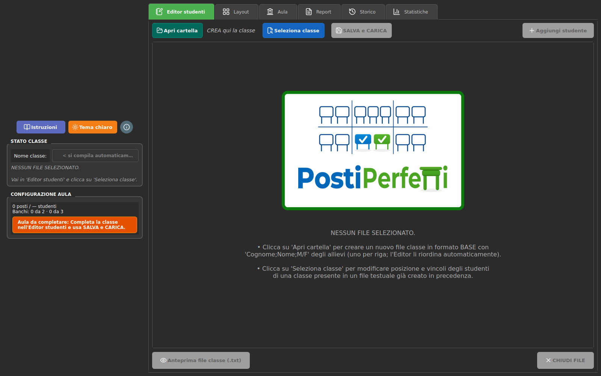
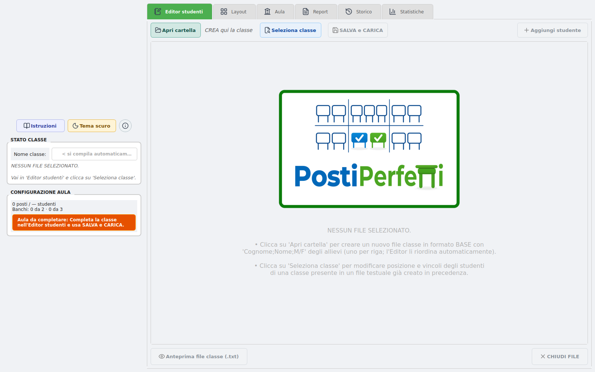
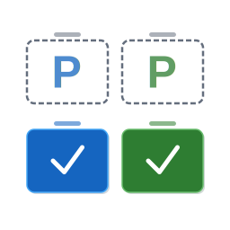

# «PostiPerfetti»

> **Versione di riferimento: 2.0, in sviluppo.** Le Release già pubblicate conservano la propria versione; le istruzioni di download si riferiscono agli asset effettivamente disponibili.

**«PostiPerfetti» è un programma gratuito e open source che aiuta gli insegnanti ad assegnare e ruotare i posti in classe.**

Tiene conto della disposizione dei banchi, delle esigenze dei singoli studenti, di affinità e incompatibilità, delle preferenze di posizione e delle vicinanze già usate nelle assegnazioni precedenti. Gli studenti possono essere disposti **in banchi da due e da tre nello stesso Layout**, generando una singola disposizione o programmando più mesi insieme.

Le assegnazioni possono essere conservate nello **Storico**, analizzate tramite Report e Statistiche ed esportate in **Excel** o in formato testuale.

### 🌐 **Sito web e guida illustrata:** [www.postiperfetti.it](https://postiperfetti.it/)

> [!NOTE]
>
> A seconda delle tue preferenze, puoi usare un'interfaccia con un **🌙 Tema scuro** o un **☀️ Tema chiaro** (clicca per ingrandire le immagini):
> 
> 
> 
> 

------

## 📥 Download

📦 **[Scarica «PostiPerfetti» per Windows e GNU/Linux](https://github.com/Omar-Ceretta/PostiPerfetti/releases)**

📖 [Installazione, aggiornamento e disinstallazione](INSTALLAZIONE.md) — istruzioni passo per passo per Windows e GNU/Linux.

------
## ✨ Cosa può fare

«PostiPerfetti» permette di:

- disporre gli studenti in **banchi da due e da tre**, anche mescolati nello stesso **Layout**, adattando la configurazione alla propria aula;
- indicare esigenze di "**posizione**" rispetto alla cattedra: PRIMA, ULTIMA e FISSO;
- definire "**affinità**" e "**incompatibilità**" fra studenti, con tre diversi livelli di importanza;
- favorire, se lo si desidera, **vicinanze miste maschio + femmina**;
- generare una singola disposizione con la modalità "**Mensile**", oppure programmare **fino a 10 mesi** con un'unica elaborazione in modalità "**Annuale**";
- tener conto delle vicinanze già sperimentate grazie allo **Storico** delle assegnazioni;
- controllare i risultati ottenuti tramite le schede "**Disposizione**", "**Report**" e "**Statistiche**";
- **modificare manualmente** i posti del Mensile o i singoli mesi dell’Annuale prima del salvataggio, con Drag & Drop, avvisi sui vincoli e possibilità di ripristino;
- esportare le disposizioni dei banchi in formato **Excel** e i Report in formato testuale.

------
## 🚀 Come funziona

1. **Crea il file della classe** con cognome, nome e genere degli studenti.
2. Nella scheda "**Editor studenti**", aggiungi tutte le indicazioni che ti servono: "posizione", "affinità" e "incompatibilità".
3. Clicca su **"SALVA e CARICA"** e configura l'aula nella scheda **"Layout"**: aggiungi banchi da due o da tre, spazi liberi, zone davanti e in fondo e l'eventuale posto FISSO. Puoi inoltre attivare la preferenza per vicinanze di genere misto.

   I Layout vengono riconosciuti dall'elenco degli studenti **e dal nome dello studente FISSO** (se previsto), indipendentemente dal nome del file. Se cambia il FISSO, o la classe e' soltanto simile a una gia' salvata, PostiPerfetti propone di recuperare la geometria chiedendo conferma. Un'eventuale ancora FISSO precedente viene rimossa se il FISSO e' cambiato: sara' necessario impostarne una nuova quando richiesta. Il Layout di origine viene conservato. L'archivio dei Layout usa il **formato versione 2**, senza conversione automatica dal formato precedente.
4. Scegli **Mensile** per una singola disposizione oppure **Annuale** per generarne più di una.
5. Controlla il risultato, eventualmente ritocca i posti con **Modifica posti**, poi salva nello **Storico** la disposizione definitiva. Nell’Annuale le modifiche di un mese aggiornano i report delle rotazioni successive. Potrai poi esportare e stampare i risultati. Tramite le "Statistiche" sarai in grado di analizzare nel tempo le caratteristiche delle diverse rotazioni.

📖 Per tutti i passaggi, gli esempi e i video dimostrativi consulta la **[guida completa sul sito](https://postiperfetti.it/guida.html)**. La stessa applicazione contiene inoltre una guida offline accessibile dal pulsante **"Istruzioni"**.

------
## 🧭 Tre cose importanti da sapere

### 1. Vincoli assoluti e preferenze

Le "**incompatibilità di livello 3**" e le posizioni "**PRIMA**" e "**FISSO**" sono vincoli assoluti e non vengono mai violati dall'algoritmo del programma.

Gli altri criteri - incompatibilità di livello 1 e 2, affinità, posizione ULTIMA e preferenza per il genere misto - sono invece *preferenze*. Se non è possibile soddisfarle tutte contemporaneamente, «PostiPerfetti» le gestisce in modo progressivamente più flessibile per cercare una disposizione valida.

Se ci sono studenti con preferenza **ULTIMA**, ma nel Layout i posti **IN FONDO** sono insufficienti o assenti, prima del Mensile e dell’Annuale compare un **promemoria non bloccante**: puoi tornare a completare il Layout oppure continuare ugualmente. Le zone non sono dedotte automaticamente dalla posizione grafica dei banchi.

### 2. Lo Storico è la memoria delle rotazioni

Soltanto le assegnazioni **salvate nello Storico** vengono considerate nelle generazioni successive.

Per questo è importante conservare solo le disposizioni realmente utilizzate in classe, ed eliminare, invece, quelle salvate ma poi non effettivamente applicate.

### 3. Banchi da due e da tre condividono la memoria del Layout

Nel **Layout unico** le vicinanze reali dei banchi da due e da tre alimentano la stessa memoria delle rotazioni. In un terzetto in fila contano i due abbinamenti consecutivi, non quello fra gli estremi. Le vecchie assegnazioni delle modalità "coppie" e "terzetti" restano leggibili ed esportabili, ma conservano le proprie memorie separate e non vengono unite automaticamente a quella del Layout unico.

------
## 🔐 Privacy e dati

**«PostiPerfetti» lavora in locale e non invia i dati delle classi a servizi remoti.**

I file delle classi, lo Storico e gli altri dati dell'utente restano sul computer e **non vengono cifrati dal programma**: devono quindi essere protetti come qualsiasi altro documento contenente dati personali.

Per maggiori informazioni consulta **[Dati locali, privacy e sicurezza](documentazione/DATI_PRIVACY_E_SICUREZZA.md)**.

------

## 📚 Altri documenti

| Documento | Cosa contiene |
|---|---|
| **[INSTALLAZIONE E AVVIO](documentazione/INSTALLAZIONE_AVVIO_E_DISINSTALLAZIONE.md)** | Installazione, aggiornamento e disinstallazione su Windows e GNU/Linux, passo per passo. |
| **[CHANGELOG](CHANGELOG.md)** | Le novità e le correzioni di ogni versione pubblicata. |
| **[SECURITY](SECURITY.md)** | Come segnalare un problema di sicurezza — e, soprattutto, **quali dati non allegare mai** a una segnalazione. |
| **[TERZE PARTI](TERZE_PARTI.md)** | Le librerie, il carattere e le icone di altri autori usati dal programma, con le rispettive licenze. |
| **[LICENSE](LICENSE)** | Il testo completo della GNU GPL versione 3. |

### 😎 PER CHI DESIDERA APPROFONDIRE

La documentazione tecnica più estesa (funzionamento dell'algoritmo, mappa dei moduli, trattamento dei dati) si trova nella cartella **[`documentazione/`](documentazione/)**: in particolare, **[Come funziona](documentazione/COME_FUNZIONA.md)** conserva la spiegazione estesa dei Tentativi e della scelta finale.

------

**«PostiPerfetti»** — sviluppato dal prof. Omar Ceretta

Istituto Comprensivo di Tombolo e Galliera Veneta (PD)

**Tecnologie:** Python · PySide6 (Qt) · XlsxWriter

**Licenza:** [GNU GPLv3](LICENSE)
